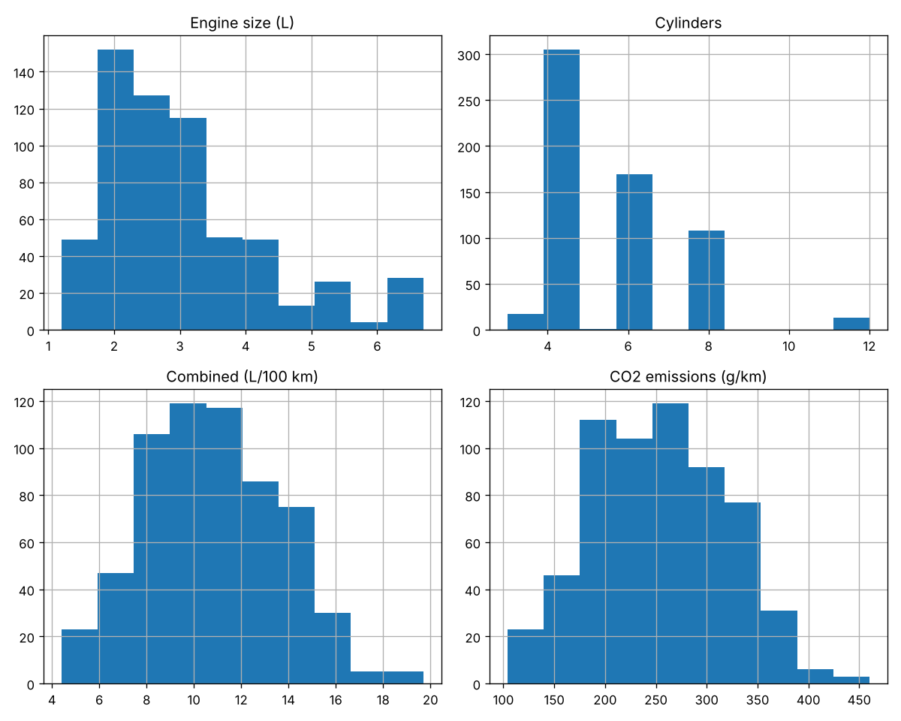
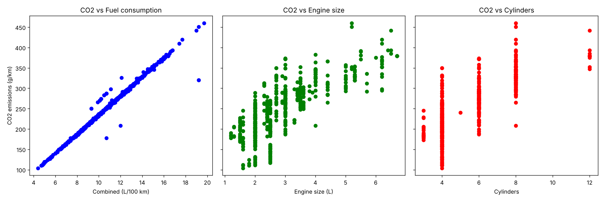
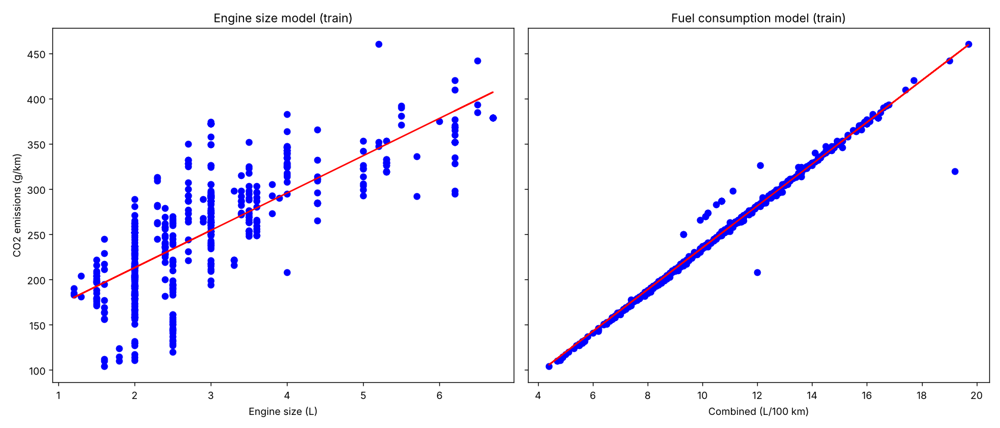

# Predicting Vehicle CO2 Emissions with Simple Linear Regression

A machine-learning project that predicts the CO2 emissions of 2026 vehicles from a single feature,
and compares two features: **engine size** and **fuel consumption**.

📓 **Full walkthrough with code, explanations and charts:** [`simple_linear_regression.ipynb`](simple_linear_regression.ipynb)

## Results (test set)

| Metric | Engine size model | Fuel consumption model |
|---|---|---|
| MAE (g/km) | 29.75 | **3.75** |
| MSE | 1601.21 | **201.03** |
| RMSE (g/km) | 40.02 | **14.18** |
| R² | 0.596 | **0.949** |

| Model | Fitted line |
|---|---|
| Engine size | CO2 = 41.28 × Engine size + 130.46 |
| Fuel consumption | CO2 = 23.11 × Fuel consumption + 4.06 |

**Findings**

- **Fuel consumption is the best predictor of CO2** (correlation 0.988, R² ≈ 0.95).
- **Engine size is related to CO2 but weaker** (correlation 0.772, R² ≈ 0.60).
- **Cylinders** has an upward trend but a large spread (correlation 0.764).
- The largest errors of the fuel model come from diesel and E85 ethanol vehicles, which is why its RMSE is much larger than its MAE.

## Charts

### Distribution of each feature


### Which feature is most linear with CO2?


### Fitted lines on the training data


## Workflow

1. Load the data (613 vehicles, 15 columns)
2. Understand the data: columns, missing values, summary statistics
3. Explore: histograms, scatter plots, correlation
4. Split 80% training / 20% test (`random_state=42`)
5. Train two `LinearRegression` models
6. Plot the fitted lines on the training data
7. Evaluate on the test data with MAE, MSE, RMSE and R²

## Project structure

```
├── simple_linear_regression.ipynb     # Walkthrough with explanations and outputs
├── simple_linear_regression.py        # Same analysis as a Python script
├── my2026-fuel-consumption-ratings.csv
├── images/                            # Saved charts
├── requirements.txt
└── README.md
```

## How to run

```bash
pip install -r requirements.txt
python simple_linear_regression.py
```

## Data source

Natural Resources Canada, Fuel consumption ratings, 2026 model year.
